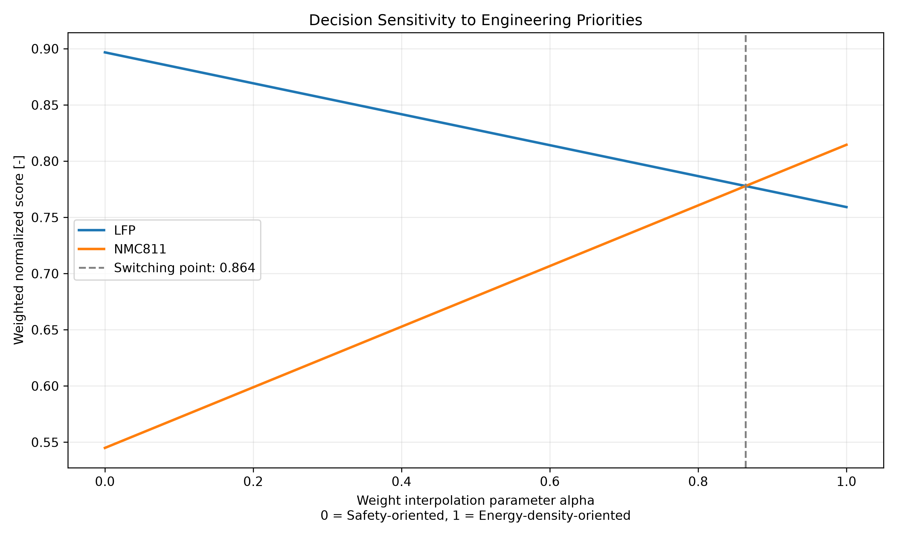
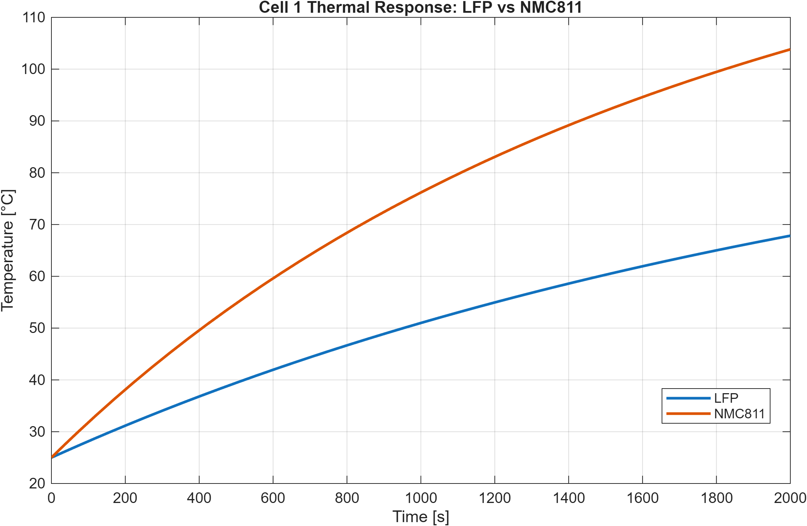
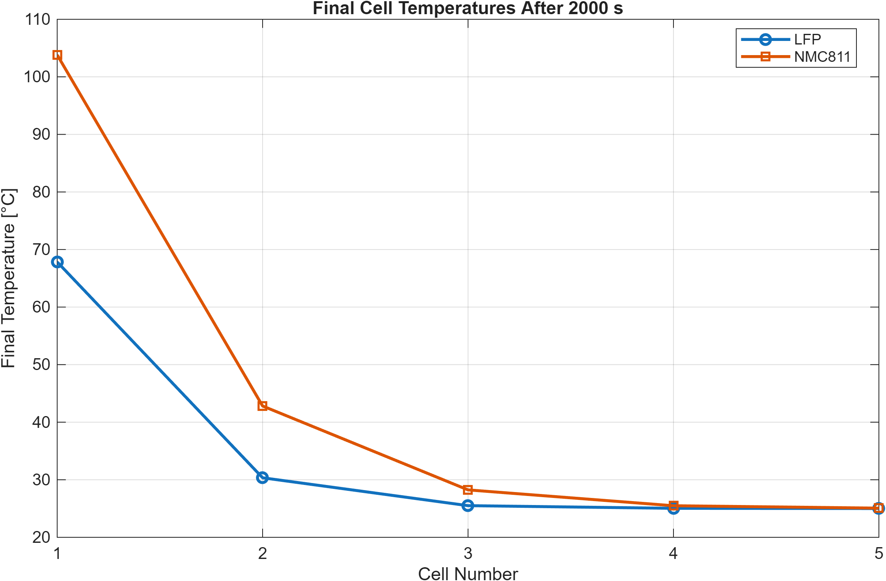
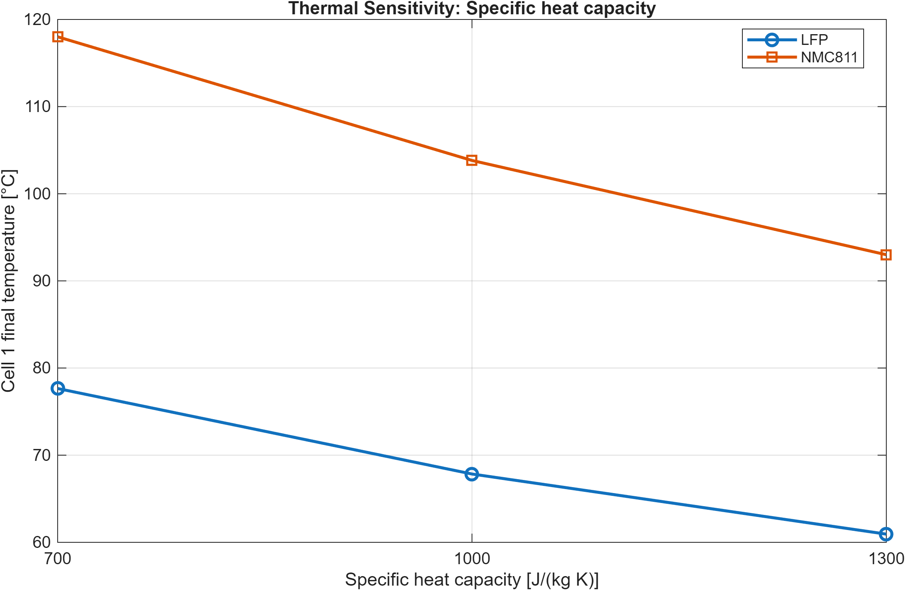
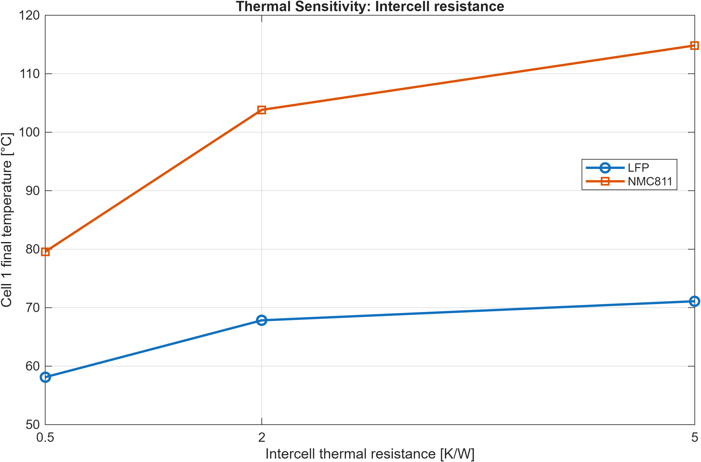
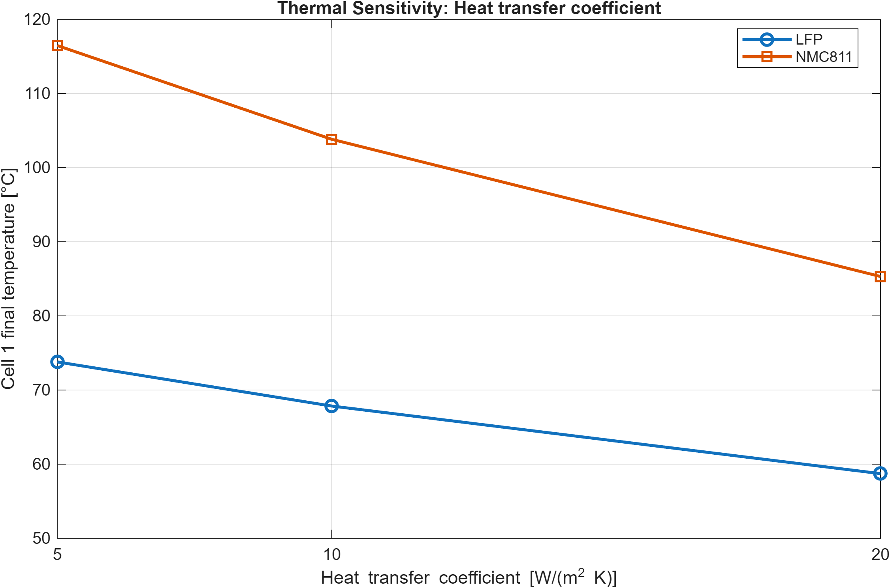
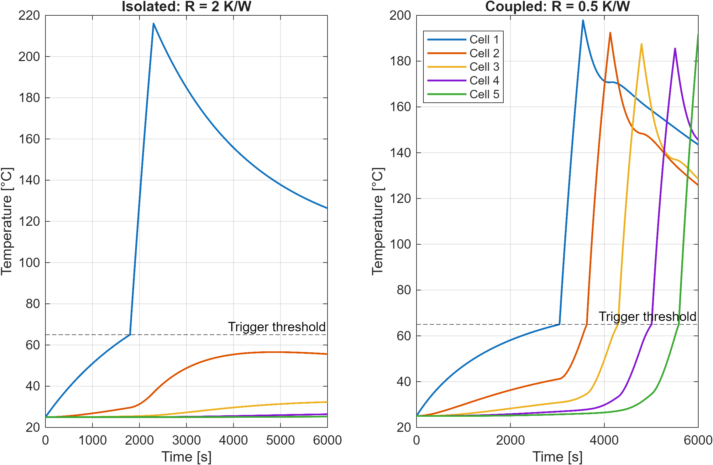
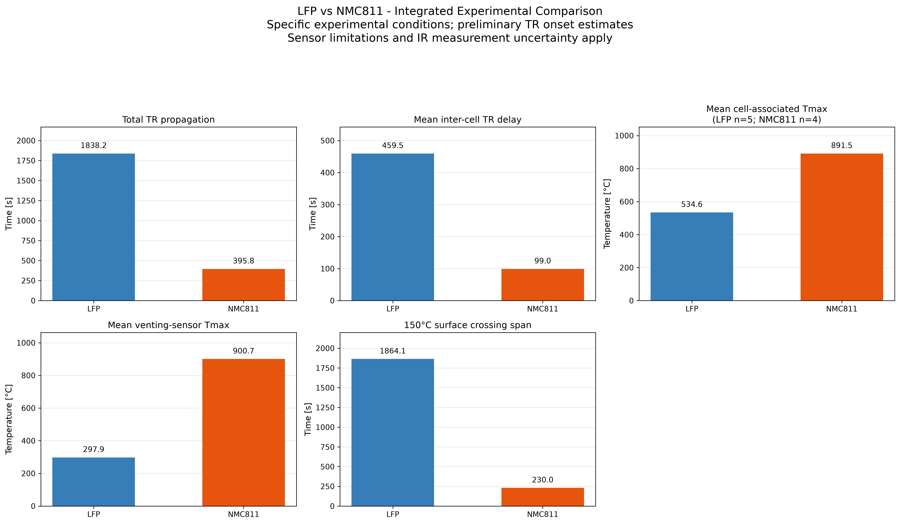
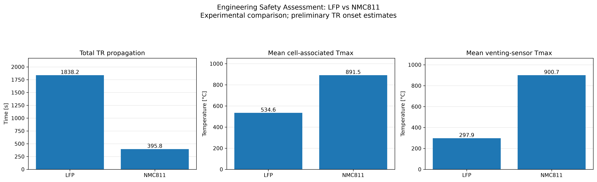
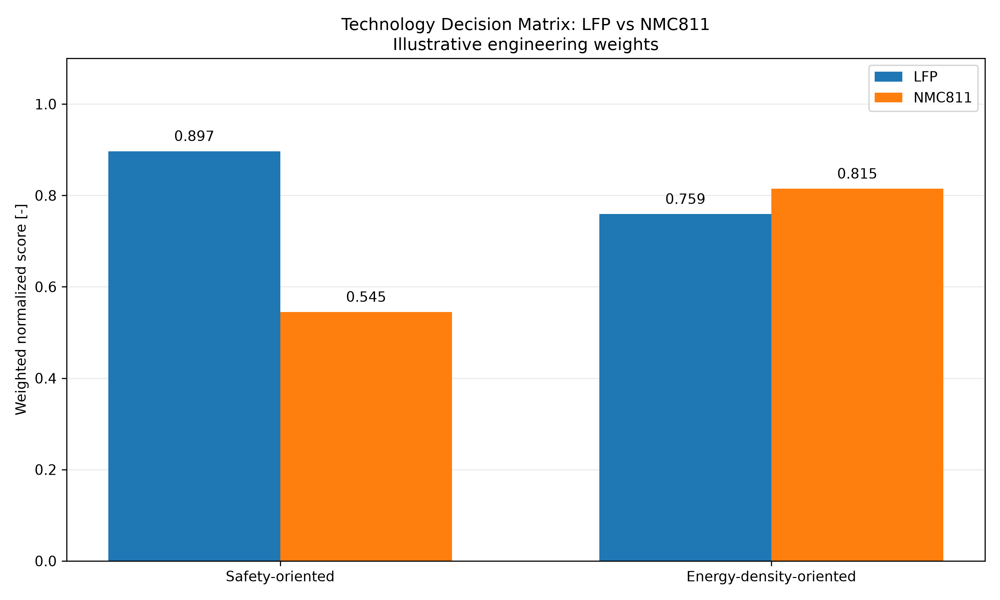

# Final Engineering Report

## Battery Thermal Safety Assessment: LFP vs NMC811

**Type:** Independent secondary experimental-data analysis and illustrative physics-based thermal modeling  
**Updated:** 2026-10-30  
**Reference:** Schöberl et al., ‘Thermal runaway propagation in automotive lithium-ion batteries with NMC-811 and LFP cathodes: Safety requirements and impact on system integration’, eTransportation 19 (2024), 100305. DOI: `10.1016/j.etran.2023.100305`. Dataset DOI: `10.14459/2023mp1717758`.

## 1. Executive summary

The published five-cell arrangements exhibit distinct thermal-runaway behavior. The LFP configuration has an estimated total propagation duration of **1838.20 s**, compared with **395.80 s** for NMC811, a duration ratio of **4.64**. NMC811 has higher measured peak thermocouple and venting-sensor temperatures in the analyzed records, while offering higher cell-level energy density. The MCDA ranking changes with the chosen application priorities. These conclusions are specific to the tested cells and conditions. A complementary five-cell lumped thermal model in MATLAB/Simulink explores passive heat transfer, parameter sensitivity and illustrative temperature-triggered propagation. The simulations are not experimentally calibrated or validated and are not used to infer chemistry-specific TR kinetics.

## 2. Research question and experimental basis

**Question:** How do observed thermal-runaway propagation, temperature severity and cell energy density influence an automotive battery-chemistry selection?

The original experiments used **five prismatic cells of each chemistry**, 100% state of charge, with external heating to initiate TR. Cells were **not electrically connected**. The heater power differed: **600 W for NMC811** and **1200 W for LFP**, reflecting different heater/contact geometries; the study reports a nominal heat flux of approximately **6.2 W/cm²** in both setups. Similar nominal heat flux does not make all boundary conditions equivalent. Cell sizes, capacities and geometry differ, so chemistry alone cannot explain every observed difference.

**Measurement modalities must remain separate:** cell thermocouples (T channels), cell voltages (U channels), vent thermocouples (V channels), and spatially resolved infrared camera profiles.

## 3. Data processing and analytical methodology

### 3.1 Inspection and cleaning

The project inspects time-series headers, sampling intervals and signal ranges, removes physically invalid negative thermocouple readings where applicable, and diagnoses implausible spikes and abrupt changes. These steps are documented in the numbered Python scripts; **not every anomaly is automatically corrected**. The NMC811 T5 thermocouple is excluded from the reported cell-associated Tmax average because of artifacts. LFP T1 is affected by reported sensor damage after approximately 185.9 s, and its maximum occurs close to that limit.

### 3.2 Preliminary TR onset identification

The reference study combines **dU/dt < 0** and a **simultaneous cell-surface temperature rate dT/dt > 10 K/s**. The Python workflow estimates candidates using voltage and temperature evidence, but smoothing, numerical differentiation, time alignment and sensor choice can affect exact onset times. **These event times are not independently validated against all original video/event annotations.** A late voltage collapse to zero is not automatically the onset of TR.

### 3.3 Propagation timing

For ordered candidate onset times t₁ ... t₅:

- Inter-cell delay: **Δtᵢ = tᵢ₊₁ − tᵢ** for i = 1...4.
- Total propagation duration: **Δt_total = t₅ − t₁**.
- Mean delay: **(Σ Δtᵢ) / 4**.

These quantities represent elapsed event times, **not** physical propagation velocities. They do not provide guaranteed detection or evacuation margins.

### 3.4 Thermal and venting severity

For each usable thermocouple, the workflow evaluates the maximum recorded temperature and related exposure indicators. The chemistry-level mean cell-associated Tmax is an **average of individual sensor maxima**, not a maximum of the average temperature trace and not a cell-core temperature. Usable sensor counts differ (LFP n=5; NMC811 n=4). Venting Tmax similarly summarizes local vent thermocouple maxima, not gas enthalpy, released heat or total gas volume.

### 3.5 Infrared surface analysis

Spatially resolved IR channels are analyzed as temperature-versus-time signals. Heatmaps and first crossings of **100, 150 and 200 °C** provide spatial heating diagnostics. The emissivity-control tape was rated to approximately **250 °C**; above this level, measurement uncertainty increases. Channel indices must not be converted into millimetres or m/s without independently verified spatial calibration. IR threshold-crossing spans are not equivalent to cell TR propagation durations.

### 3.6 Multi-criteria decision analysis (MCDA)

Five criteria are used: TR propagation duration (larger preferred), cell-associated Tmax (smaller), venting Tmax (smaller), gravimetric energy density (larger), and volumetric energy density (larger).

- Benefit criterion: **sᵢⱼ = xᵢⱼ / maxᵢ(xᵢⱼ)**.
- Cost criterion: **sᵢⱼ = minᵢ(xᵢⱼ) / xᵢⱼ**.
- Weighted score: **Sᵢ = Σⱼ wⱼ sᵢⱼ**, with **Σⱼ wⱼ = 1**.

Scores are relative to the compared alternatives. Weights are **illustrative engineering preferences**, not experimentally established risk weights. The three thermal criteria may partially overlap, so the MCDA must not be read as a validated safety index.

## 4. Integrated experimental results

| Metric | LFP | NMC811 |
| --- | --- | --- |
| Total TR propagation [s] | 1838.20 | 395.80 |
| Mean inter-cell delay [s] | 459.55 | 98.95 |
| Mean cell-associated Tmax [°C] | 534.63 | 891.54 |
| Mean venting-sensor Tmax [°C] | 297.86 | 900.73 |

### 4.1 Cell-level onset candidates and sensor observations

| Chemistry | Cell | TR onset candidate [s] | Propagation delay [s] | Temperature sensor | Cell-associated Tmax [C] | Venting sensor | Venting Tmax [C] | TR onset status |
| --- | --- | --- | --- | --- | --- | --- | --- | --- |
| LFP | 1.00 | 183.90 | N/A | T1 | 605.79 | V1 | 368.78 | PRELIMINARY - manual validation pending |
| LFP | 2.00 | 647.90 | 464.00 | T2 | 520.69 | V2 | 169.30 | PRELIMINARY - manual validation pending |
| LFP | 3.00 | 1153.90 | 506.00 | T3 | 518.96 | V3 | 260.22 | PRELIMINARY - manual validation pending |
| LFP | 4.00 | 1650.00 | 496.10 | T4 | 496.80 | V4 | 391.52 | PRELIMINARY - manual validation pending |
| LFP | 5.00 | 2022.10 | 372.10 | T5 | 530.90 | V5 | 299.49 | PRELIMINARY - manual validation pending |
| NMC811 | 1.00 | 156.50 | N/A | T1 | 852.90 | V1 | 718.55 | PRELIMINARY - manual validation pending |
| NMC811 | 2.00 | 210.30 | 53.80 | T2 | 935.42 | V2 | 940.31 | PRELIMINARY - manual validation pending |
| NMC811 | 3.00 | 287.60 | 77.30 | T3 | 906.42 | V3 | 623.92 | PRELIMINARY - manual validation pending |
| NMC811 | 4.00 | 379.30 | 91.70 | T4 | 871.42 | V4 | 1232.18 | PRELIMINARY - manual validation pending |
| NMC811 | 5.00 | 552.30 | 173.00 | T5 | N/A | V5 | 988.70 | PRELIMINARY - manual validation pending |

**N/A** denotes a missing or excluded measurement, not zero. Cell 1 has no preceding inter-cell propagation delay.

### 4.2 Interpretation

LFP propagation is **4.64 times longer** than NMC811 in the analyzed configuration. The NMC811 cell-associated mean Tmax exceeds the LFP mean by **356.91 °C**; the corresponding venting-sensor difference is **602.87 °C**. These differences describe measured local sensor indicators, not total heat release or a universal chemistry effect.

## 5. Comparison with published reference results

The reference article reports a **mean LFP inter-cell TR interval of approximately 460.8 s**. Our derived mean is **459.55 s**, a difference of **-1.25 s**. This is a useful consistency check, **not independent proof** that each onset time is correct.

The article also reports mean maximum thermocouple temperatures of approximately **524.4 °C (LFP)** and **899.3 °C (NMC811)**. Our means are **534.63 °C** and **891.54 °C**, respectively. **Do not interpret the numerical differences as measurement error without matching the article's sensor selection, exclusion rules and aggregation definition.** LFP T1 near damage and NMC811 T5 artifacts are particularly relevant.

The study's qualitative findings about reaction duration, ignition, mass loss and venting behavior must not be confused with direct calorimetry or measurements reproduced by this project. A complete independent event-by-event validation remains future work.

## 6. Technology decision matrix

### 6.1 Raw decision criteria

| Criterion | LFP | NMC811 |
| --- | --- | --- |
| TR propagation [s] | 1838.20 | 395.80 |
| Cell Tmax [C] | 534.63 | 891.54 |
| Venting Tmax [C] | 297.86 | 900.73 |
| Gravimetric energy density [Wh/kg] | 168.00 | 248.00 |
| Volumetric energy density [Wh/L] | 361.00 | 569.00 |

The energy-density values refer to the **specific tested cells**, not complete automotive battery packs.

### 6.2 Normalized scores

| Criterion | LFP | NMC811 |
| --- | --- | --- |
| TR propagation [s] | 1.0000 | 0.2153 |
| Cell Tmax [C] | 1.0000 | 0.5997 |
| Venting Tmax [C] | 1.0000 | 0.3307 |
| Gravimetric energy density [Wh/kg] | 0.6774 | 1.0000 |
| Volumetric energy density [Wh/L] | 0.6344 | 1.0000 |

### 6.3 Scenario weights

| Criterion | Safety-oriented | Energy-density-oriented |
| --- | --- | --- |
| TR propagation [s] | 0.35 | 0.10 |
| Cell Tmax [C] | 0.20 | 0.10 |
| Venting Tmax [C] | 0.15 | 0.10 |
| Gravimetric energy density [Wh/kg] | 0.15 | 0.35 |
| Volumetric energy density [Wh/L] | 0.15 | 0.35 |

### 6.4 Scenario outcomes

| Chemistry | Safety-oriented | Energy-density-oriented |
| --- | --- | --- |
| LFP | 0.8968 | 0.7592 |
| NMC811 | 0.5449 | 0.8146 |

The **safety-oriented** scenario favors **LFP**, while the **energy-density-oriented** scenario favors **NMC811** under the selected weights.

### 6.5 Sensitivity analysis

The interpolation between the two specified weight vectors produces a decision crossover at **α = 0.8639**. Alpha measures the position along this interpolation, **not** the percentage weight of energy density. The 101-point series is retained in `results/technology_sensitivity_analysis.csv` rather than repeated as a long report table. This one-dimensional sensitivity path does not exhaust all possible weighting combinations or quantify uncertainty in the experimental inputs.

## 7. MATLAB/Simulink thermal modeling

### 7.1 Purpose and relationship to the experimental analysis

The Python workflow quantifies what was observed in the published five-cell LFP and NMC811 experiments. The MATLAB/Simulink workflow investigates how heat capacity, cell geometry, convection and thermal coupling influence a simplified five-cell temperature response. Both parts use five-cell arrangements and the tested cells' nominal masses and dimensions. They **do not** use equivalent heating conditions, identified thermal properties or experimentally calibrated TR kinetics. Therefore the MATLAB predictions must **not** be plotted or interpreted as quantitative reproductions of the experimental TR curves.

### 7.2 Passive five-cell lumped thermal network

Each cell is represented by one spatially uniform temperature state. For cell *i*:

\[
 m_i c_{p,i}\frac{dT_i}{dt} = Q_{\mathrm{heater},i} + Q_{\mathrm{TR},i} + \sum_{j\in\mathcal N(i)}\frac{T_j-T_i}{R_{ij}} - h A_i(T_i-T_{\infty}).
\]

In the passive model, \(Q_{\mathrm{TR},i}=0\). The model uses the full rectangular-prism surface area \(A_i=2(L_iW_i+L_iH_i+W_iH_i)\), uniform convection on all faces and coupling only between neighboring cells. These are simplifying assumptions; real contact and exposed areas may differ.

| Parameter | LFP | NMC811 | Basis |
| --- | ---: | ---: | --- |
| Cell mass [kg] | 3.10 | 1.42 | Tested-cell specification |
| Dimensions [mm] | 280 × 63 × 82 | 173 × 42 × 85 | Tested-cell specification |
| Specific heat capacity [J/(kg K)] | 1000 | 1000 | Illustrative assumption |
| Initial and ambient temperature [°C] | 25 | 25 | Simulation setting |
| Convection coefficient [W/(m² K)] | 10 | 10 | Illustrative assumption |
| Adjacent-cell thermal resistance [K/W] | 2 | 2 | Illustrative assumption |
| External heater on cell 1 [W] | 100 | 100 | Common simulation input; **not** experimental heater power |
| Simulation duration [s] | 2000 | 2000 | Simulation setting |

The thermal capacities are 3100 J/K (LFP) and 1420 J/K (NMC811). The experimental heater powers were 1200 W (LFP) and 600 W (NMC811), with approximately equal reported nominal heat flux, so the simulated common 100 W comparison isolates neither chemistry nor actual experimental operating conditions.

### 7.3 Passive simulation outcomes

| Cell | LFP final temperature [°C] | NMC811 final temperature [°C] |
| --- | ---: | ---: |
| 1 | 67.84 | 103.82 |
| 2 | 30.34 | 42.81 |
| 3 | 25.50 | 28.24 |
| 4 | 25.04 | 25.48 |
| 5 | 25.00 | 25.07 |

Under identical **assumed** specific heat, convection and intercell resistance, the smaller NMC811 cell's thermal capacity and geometry lead to higher modeled temperatures. This does **not** establish that NMC811 chemistry intrinsically heats faster under equivalent real-world conditions.

### 7.4 Numerical checks and parameter sensitivity

A passive LFP model was also constructed in Simulink using a five-state linear state-space representation. MATLAB `ode45` and Simulink agreed to a reported maximum absolute temperature discrepancy of approximately **0.004107 °C** over the compared trajectories. This is a **numerical implementation consistency check**, not experimental validation. A separate illustrative LFP energy-balance calculation over 2000 s reported 200000 J heater input, 151039.45 J stored-energy increase and 48957.96 J ambient loss, with a residual of approximately 2.59 J (0.001296%).

The one-at-a-time sensitivity analysis varied \(c_p\) over 700, 1000 and 1300 J/(kg K); \(R\) over 0.5, 2 and 5 K/W; and \(h\) over 5, 10 and 20 W/(m² K), for 18 simulations across both cell types. In this model, greater specific heat or convection reduces the heated cell's final temperature. Greater adjacent-cell thermal resistance generally raises the heated cell's temperature while reducing transfer to its neighbors. These trends are conditional on the chosen network assumptions.

### 7.5 Illustrative temperature-triggered thermal runaway scenarios

A separate **LFP-geometry demonstration**, implemented in `matlab/scripts/step08_thermal_runaway_events.m`, adds temperature-triggered heat generation and per-cell energy tracking. An event-driven integration detects temperature-threshold crossings and energy exhaustion. The model uses a **65 °C illustrative trigger**, **1000 W illustrative TR heating**, a **500 kJ per-cell energy budget**, a continuous **100 W heater** on cell 1 and a **6000 s** horizon. These are demonstration inputs, **not experimentally determined TR parameters or physically validated ignition thresholds**.

| Scenario | Intercell resistance [K/W] | Triggered cells | Key outcome |
| --- | ---: | ---: | --- |
| Isolated | 2.0 | 1/5 | Only cell 1 triggers; cell 2 maximum is 56.56 °C |
| Coupled | 0.5 | 5/5 | Sequential threshold crossing in all five cells |

In the isolated case, cell 1 triggers at **1799.1 s** and reaches **216.01 °C**. In the coupled case, trigger times for cells 1–5 are approximately **3045.5, 3626.3, 4292.4, 5006.5 and 5584.8 s**. Cells 1–4 each release 500 kJ, while cell 5 releases 415.24 kJ before the simulation ends. No per-cell budget exceedance was reported. The coupling parameter changes **both** the first-cell trigger time and subsequent propagation; these results cannot be mapped to measured LFP/NMC811 onset times or safety margins.

### 7.6 Cross-workflow interpretation

| Python experimental observation | MATLAB/Simulink contribution | Evidentiary boundary |
| --- | --- | --- |
| Five-cell TR events and inter-cell timing differ between the tested configurations | Five-node network represents sequential heat transfer and possible temperature-triggered activation | No fitted propagation timing; no causal attribution to chemistry |
| Cell-associated and venting thermocouple maxima differ | Thermal capacity and heat-loss sensitivities clarify how modeled temperatures depend on physical parameters | Lumped cell temperatures are not thermocouple/vent peaks |
| Tested LFP and NMC811 cells have different masses and dimensions | Uses these masses and dimensions in the passive thermal comparison | Assumed heat capacity, coupling and convection are not measured |
| Safety-versus-energy-density trade-off changes with decision priorities | Thermal network offers mechanism-level design intuition about coupling and cooling | No independent pack-level hazard or safety validation |

The two workflows therefore form a **measurement-led assessment plus a complementary mechanism demonstration**, rather than a calibrated predictive digital twin.

## 8. Engineering implications

The tested LFP configuration shows slower sequential TR propagation and lower local peak-temperature indicators. These observations may be useful when considering thermal barriers, vent routing, monitoring and protection strategies. NMC811 offers higher reported cell-level gravimetric and volumetric energy density. Neither chemistry is universally superior: cell format, pack structure, cooling, electrical connections, cost, aging and charging requirements matter.

## 9. Limitations and uncertainty

1. **Experimental comparability:** Different cell geometries, capacities and heater powers; the tests are not chemistry-only controlled comparisons.
2. **Onset uncertainty:** Algorithmic TR candidates remain preliminary and are sensitive to derivative calculation, noise and time alignment.
3. **Thermocouple quality:** NMC811 T5 is excluded; LFP T1 is near its damage time; averages have unequal sensor counts.
4. **Venting measurements:** Sensor movement can affect maxima; vent temperatures do not quantify gas amount or released energy.
5. **Infrared uncertainty:** Tape is rated to ~250 °C; readings above that are less reliable.
6. **Spatial calibration:** No physically calibrated front speed in m/s is claimed.
7. **Statistical scope:** No repeated-experiment confidence intervals or full uncertainty propagation have been established.
8. **Pack-level extrapolation:** Five-cell, electrically disconnected arrangements do not establish pack-level hazard severity or performance.
9. **MCDA scope:** Illustrative weights, potentially correlated criteria, and omission of cost, life, fast charging and other system requirements.
10. **MATLAB model scope:** Lumped temperatures, idealized neighbor coupling and exposed surface area; constant illustrative thermal parameters; different simulated versus experimental heater powers.
11. **TR model scope:** Arbitrary illustrative threshold, heat-release power and energy budget; no electrochemical kinetics, vent-gas transport, structural failure, calibration or experimental validation.

## 10. Conclusions

1. Estimated LFP total TR propagation duration is **1838.20 s**, compared with **395.80 s** for NMC811.
2. NMC811 shows higher observed local cell-associated and venting thermocouple peak-temperature means in this dataset.
3. NMC811 has higher reported **cell-level** gravimetric and volumetric energy density.
4. The illustrative decision ranking changes with engineering priorities; the MCDA is **decision support**, not a certified safety assessment.
5. The MATLAB/Simulink model reproduces expected thermal-network behavior and demonstrates parameter sensitivity and conditional propagation, but **does not validate or predict the measured TR events**.
6. The experimental analysis remains subject to event-level onset verification and further uncertainty work before stronger generalization.

## 11. Reproducibility and future work

The numbered Python scripts in `scripts/` form the experimental analysis pipeline; the MATLAB scripts are in `matlab/scripts/`, the Simulink model in `matlab/models/`, and exported MATLAB tables and figures in `matlab/results/`. Raw measurements, intermediate outputs, derived CSVs and figures should be retained for full reproduction. The dependency inventory is a static best-effort scan, not a substitute for testing in a fresh environment.

The Python pipeline has been exercised in a clean test environment, with selected output tables checked numerically; this does not substitute for independent validation of the original onset annotations. Priority future checks: manually validate all onset candidates against original event records; verify IR channel-to-distance mapping; quantify uncertainty; assess broader MCDA weight combinations and correlated criteria. Optional future model development includes calibrating thermal parameters against appropriate pre-TR experimental data, followed by independent validation.

## 12. Selected figures

## 13. Attribution

**Article:** Schöberl et al., ‘Thermal runaway propagation in automotive lithium-ion batteries with NMC-811 and LFP cathodes: Safety requirements and impact on system integration’, eTransportation 19 (2024), 100305. DOI: `10.1016/j.etran.2023.100305`.  
**Original dataset:** DOI `10.14459/2023mp1717758`.  
The original experiments belong to the cited research team; this repository documents independent secondary analysis.
