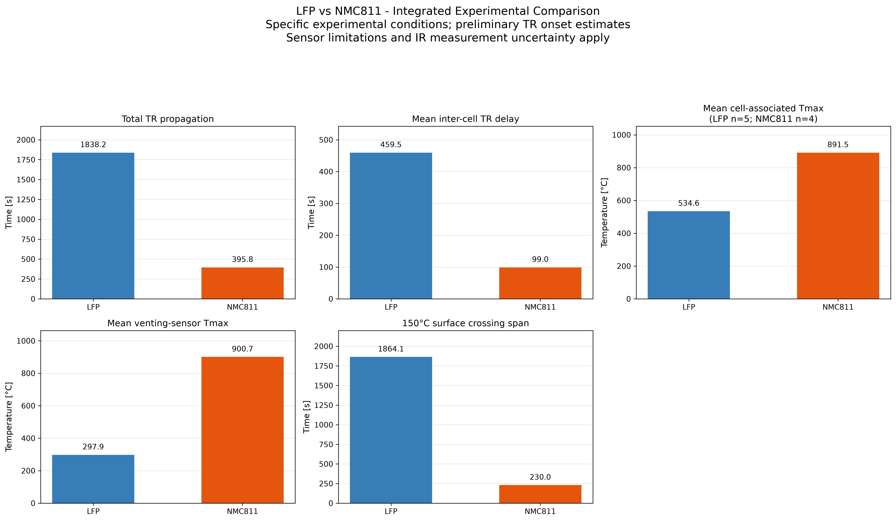
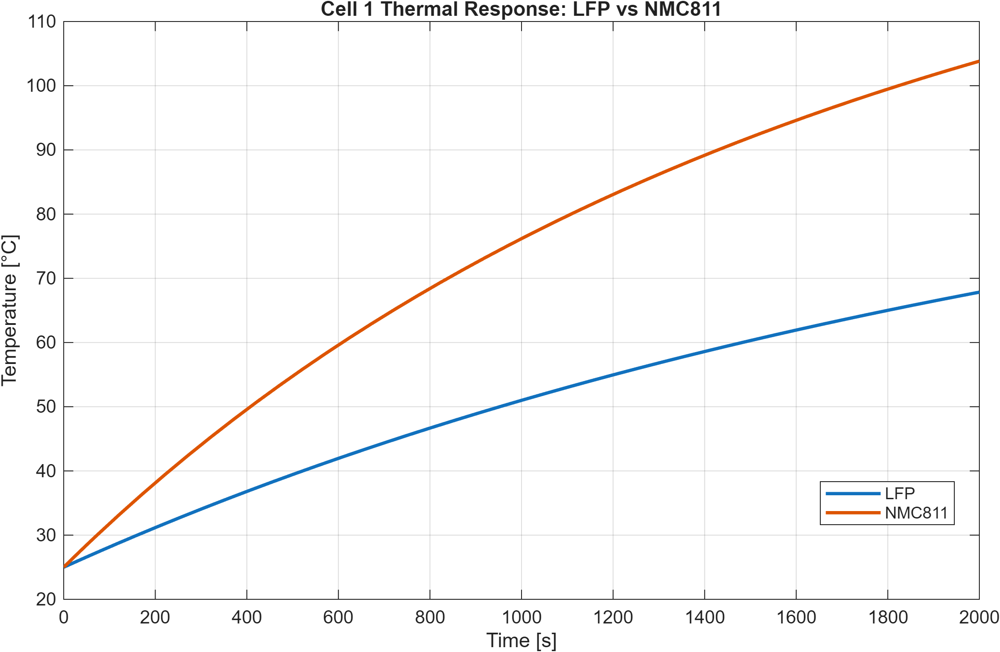
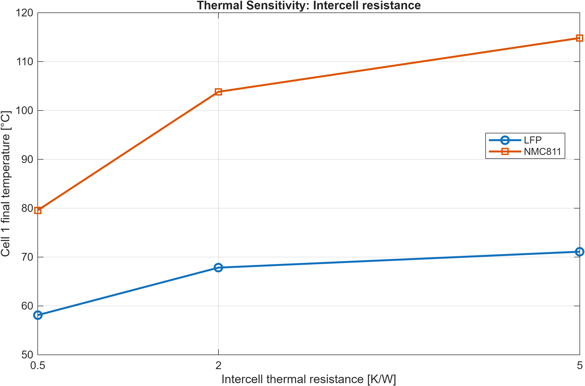
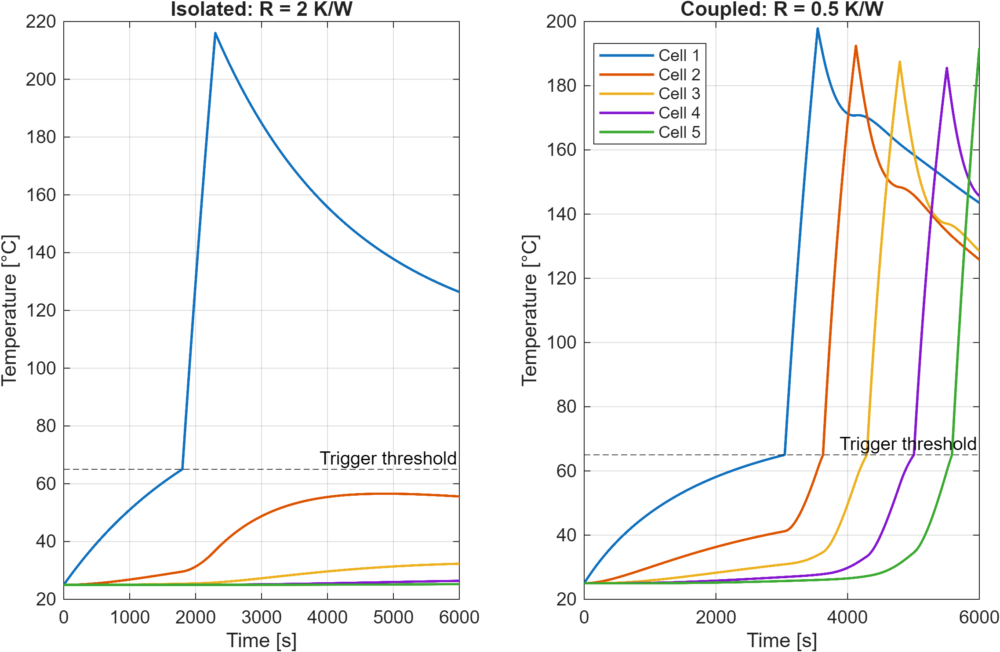

# Battery Thermal Safety Assessment: LFP vs NMC811

**Python experimental-data analysis | MATLAB/Simulink thermal modeling | Engineering safety assessment**

## Project overview

This independent engineering portfolio project investigates thermal-runaway behavior and thermal propagation in lithium-ion battery cells, comparing LFP and NMC811 configurations. It combines two complementary approaches:

1. **Python:** secondary analysis of published experimental measurements, including preliminary thermal-runaway onset identification, propagation delays, temperature severity, and an illustrative multi-criteria technology assessment.
2. **MATLAB/Simulink:** a five-cell lumped thermal-network model, chemistry-format comparisons under identical *assumed* boundary conditions, parameter sensitivity studies, and illustrative event-driven thermal-runaway propagation scenarios.

**Important distinction:** the MATLAB simulations are *not calibrated or validated* against the experimental thermal-runaway measurements. The two components investigate related phenomena at different levels; simulated temperatures and onset times should not be compared quantitatively with measured values as predictions.

## Experimental basis

Schöberl et al., *Thermal runaway propagation in automotive lithium-ion batteries with NMC-811 and LFP cathodes: Safety requirements and impact on system integration*, **eTransportation 19** (2024), 100305. DOI: **10.1016/j.etran.2023.100305**. Original dataset DOI: **10.14459/2023mp1717758**.

The study investigated five prismatic cells per configuration. The two tested cell formats differed in mass, dimensions, and applied heating power. Experimental differences therefore cannot be attributed solely to cathode chemistry.

| Experimental cell property | LFP | NMC811 |
| --- | ---: | ---: |
| Nominal voltage [V] | 3.20 | 3.65 |
| Capacity [Ah] | 163.3 | 96.3 |
| Mass [kg] | 3.10 | 1.42 |
| Gravimetric energy density [Wh/kg] | 168 | 248 |
| Volumetric energy density [Wh/L] | 361 | 569 |

## Part I: Python experimental analysis

The analysis covers data inspection and cleaning, sensor-quality diagnostics, preliminary event detection, cell-to-cell propagation delays, cell-associated and venting thermocouple temperatures, infrared measurements, and a weighted multi-criteria decision analysis (MCDA).

### Selected experimental-analysis results

| Derived metric | LFP | NMC811 |
| --- | ---: | ---: |
| Estimated first-to-last TR onset span [s] | 1838.20 | 395.80 |
| Mean inter-cell onset delay [s] | 459.55 | 98.95 |
| Mean usable cell-associated sensor maximum [°C] | 534.63 | 891.54 |
| Mean venting sensor maximum [°C] | 297.86 | 900.73 |

The estimated onset-span ratio (LFP/NMC811) is **4.64** for the investigated configurations. These are preliminary algorithm-derived event times requiring independent manual verification, not a physical propagation-front speed. Sensor-quality exclusions and differing valid channel counts affect temperature comparisons.

The illustrative MCDA favors **LFP** under safety-oriented weighting and **NMC811** under energy-density-oriented weighting. These rankings depend on chosen criteria, normalization, and subjective weights; they are not universal safety scores.



## Part II: MATLAB/Simulink thermal model

### Five-cell thermal network

Each cell is represented by one temperature state. The model includes an external heater on cell 1, heat transfer to neighboring cells, and convective heat loss to the surroundings:

\[
m_i c_{p,i}\frac{dT_i}{dt}=Q_{\mathrm{heater},i}+Q_{\mathrm{TR},i}+\sum_{j\in\mathcal N_i}\frac{T_j-T_i}{R_{ij}}-h A_i(T_i-T_\infty).
\]

For the **passive thermal comparison**, \(Q_{\mathrm{TR},i}=0\). The model uses experimental cell mass and external dimensions, but **assumed** specific heat capacity, heat-transfer coefficient, and effective inter-cell thermal resistance. The convection model approximates the entire cell surface as exposed; it does not explicitly resolve contact areas or enclosure effects.

**Illustrative baseline:** 25 °C ambient, 100 W continuous heating on cell 1, 2000 s duration, \(c_p=1000\) J/(kg K), \(h=10\) W/(m² K), \(R=2\) K/W.

| Cell | LFP final temperature [°C] | NMC811 final temperature [°C] |
| ---: | ---: | ---: |
| 1 | 67.84 | 103.82 |
| 2 | 30.34 | 42.81 |
| 3 | 25.50 | 28.24 |
| 4 | 25.04 | 25.48 |
| 5 | 25.00 | 25.07 |

The larger simulated temperature rise for the NMC811 format reflects its different mass and geometry **under the selected common modeling assumptions**, not a demonstrated intrinsic chemistry effect.



### Simulink implementation and numerical check

A five-state linear State-Space Simulink model implements the passive **LFP** network and is generated programmatically. A previously performed comparison against the MATLAB ODE implementation found a maximum interpolated temperature difference of approximately **0.0041 °C**. This is a **numerical implementation consistency check**, not experimental validation. The Simulink model is not a full thermal-runaway model.

### Parameter sensitivity

An 18-run one-factor-at-a-time study varied:

- Specific heat capacity: 700, 1000, 1300 J/(kg K)
- Effective inter-cell resistance: 0.5, 2, 5 K/W
- Convective heat-transfer coefficient: 5, 10, 20 W/(m² K)

The sensitivity results illustrate how assumptions influence predicted temperature histories and therefore why uncalibrated absolute temperatures should be interpreted cautiously.



### Illustrative thermal-runaway propagation scenarios

An event-driven model adds a threshold-triggered, fixed-power heat source with a finite per-cell energy budget. For the LFP cell format, two **hypothetical** inter-cell resistance scenarios were simulated for 6000 s with the same other settings:

| Scenario | Assumed inter-cell resistance [K/W] | Cells triggered |
| --- | ---: | ---: |
| More thermally isolated | 2.0 | 1 of 5 |
| More thermally coupled | 0.5 | 5 of 5 |

Illustrative scenario parameters include a 65 °C trigger threshold, 1000 W triggered heat generation, and a 500 kJ per-cell heat-release budget. These values **are not measured LFP thermal-runaway properties**. In the coupled scenario, cell 5 has released only approximately 415 kJ by the simulation endpoint. These cases demonstrate the mechanism of heat-transfer-mediated propagation, not experimentally predicted onset times.



## How the two parts fit together

The **experimental Python analysis** characterizes measured propagation behavior and the trade-off between thermal safety indicators and energy density. The **MATLAB/Simulink component** provides a transparent energy-balance framework for exploring how geometry, heat capacity, cooling, and inter-cell thermal resistance affect temperature development and the possibility of propagation under hypothetical trigger assumptions.

The shared physical context is the five-cell LFP/NMC811 comparison, including cell-format specifications from the same published study. **No data-driven calibration or experimental validation of the MATLAB model is claimed.**

## Repository layout

```text
.
├── README.md
├── FINAL_ENGINEERING_REPORT.md
├── requirements.txt
├── data/                     # Experimental inputs, subject to redistribution rights
├── data_cleaned/             # Processed inputs, if included
├── scripts/                  # Numbered Python analysis scripts
├── results/                  # Python analysis tables and figures
└── matlab/
    ├── scripts/              # Eight MATLAB scripts
    ├── models/
    │   └── five_cell_thermal_network.slx
    └── results/              # MATLAB CSV exports and figures
```

## Running the project

**Python:** use Python 3.10+ and the repository's `requirements.txt`:

```powershell
python -m venv .venv
.\.venv\Scripts\Activate.ps1
python -m pip install -r requirements.txt
```

Run the numbered scripts in `scripts/` in ascending order, starting with the required input data. Later scripts depend on results from earlier stages. See `FINAL_ENGINEERING_REPORT.md` for methodology and limitations.

**MATLAB:** tested during development with MATLAB R2025b and Simulink. Add `matlab/scripts/` to the MATLAB path, then run `step01_thermal_model_parameters.m` followed by the desired analysis scripts. To regenerate the passive Simulink model, run `step03_create_simulink_model.m`. The comparison, sensitivity, visualization, and event-driven scenario scripts write outputs to `matlab/results/`. The event-driven final scenario script is provided as `step08_thermal_runaway_events_final.m` in the repository; rename the uploaded `(1)` copy accordingly if needed.

## Scope and limitations

- This is an **independent secondary analysis**, not an original laboratory experiment.
- Python-derived thermal-runaway onset times remain preliminary and require manual event-level verification.
- Different cell formats and experimental heater powers confound any chemistry-only inference.
- The passive thermal model assumes uniform cell temperature, constant material properties, simplified convection, and constant effective inter-cell resistance.
- Thermal-runaway trigger thresholds, powers, and energy budgets are **hypothetical**, not identified from the experimental dataset.
- Simulink/MATLAB numerical agreement is not evidence of physical accuracy.
- The MCDA is an illustrative decision-support exercise, not a certified battery safety classification.

## Attribution

The experimental measurements originate from the cited Schöberl et al. publication and associated dataset. Please consult the original source and dataset terms before redistributing raw experimental files. All analysis and modeling should be distinguished from the original authors' experimental findings.
